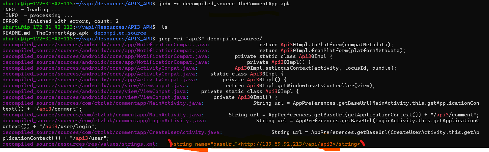
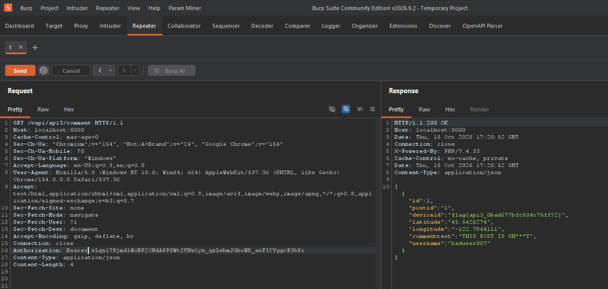

# 🛑 API 3: Excessive Data Exposure (Static Binary Analysis)

* **OWASP Class:** API3:2023 - Excessive Data Exposure
* **Risk Severity:** High 🔴
* **Target Artifact:** `TheCommentApp.apk`
* **Target Endpoint:** `/vapi/api3/comments`
* **Vulnerability Type:** Hardcoded Sensitive Cryptographic Keys / Data Leakage

---

### 🔍 Vulnerability Profile
The `/vapi/api3/comments` endpoint returned excessive data when accessed using a previously obtained authentication token. The response included a flag and location coordinates, indicating that the API may expose sensitive properties beyond those required for its intended functionality.

### 🔬 Technical Discovery (Reverse Engineering)
A Static Application Security Testing (SAST) review was performed directly on the client binary file (`TheCommentApp.apk`) using automated reverse-engineering suites to reconstruct the source architecture:

1. **Bytecode Reconstruction:** The target APK package was decompiled into near-original Java framework layouts to trace backend data exposure models.
2. **String Pattern Matching:** A standard global text match sequence looking for structural flags or application variables exposed the environment values. 

The flag asset was discovered natively embedded within the decompiled class resources without requiring an active server connection or dynamic interception channels:

<kbd>
  
</kbd>

### 🔬 Manual Discovery (JADX-GUI and API Testing)

**1. APK Decompilation**

JADX-GUI was used to decompile the Android application package (APK). The decompiled application was examined to understand its API request flow and identify the endpoint used to retrieve comments.

**2. Endpoint Identification**

Further analysis identified the following endpoint:

`/vapi/api3/comments`

**3. Response Validation**

A previously obtained authentication token was used to access the endpoint. Inspection of the resulting response revealed additional data, including a flag and location coordinates.

This demonstrated that the endpoint returned data beyond the expected comment information. The authorization requirements for the exposed properties should be assessed against the application's intended behavior.

### 🖥️ Output Results

The successful request returned a response containing the observed flag and location coordinates.

**Evidence:** 
<kbd>
    
</kbd>

### 🛠️ Remediation
1. **Implement Secret Management:** Completely remove sensitive environment markers, static flags, and hardcoded private configuration attributes from the application source layers.
2. **Code Obfuscation:** Integrate production build minification frameworks (such as ProGuard or R8 shrinkers) to scramble raw code logic, classes, and variable descriptors prior to compilation to disrupt automated binary reading tools.
3. **Data Minimization:** Ensure any necessary app logic queries restrict backend payloads to output exclusively public, low-risk operational layout variables to the client device.

